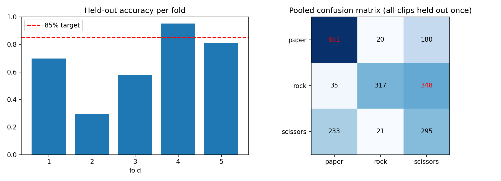

# Rock-Paper-Scissors: custom CNN + live camera GUI (Applied Computer Vision)

A convolutional network **trained from scratch** (no pretrained weights) that classifies rock / paper /
scissors hand signs, with W&B logging, grouped K-fold evaluation, and a real-time laptop-camera GUI.

## Repository layout
| File | Purpose |
|---|---|
| `build_dataset.py` | Builds the ImageFolder dataset from raw stills + videos, split by source clip (no leakage) |
| `model.py` | **The model** (`RPSNet`, ~1.2M params) + lighting/geometry augmentation + preprocessing |
| `train.py` | Single train/val/test run, class-imbalance options (balanced sampler / weights), CE or focal loss, lighting-robustness test |
| `kfold.py` | Grouped K-fold cross-validation + final model trained on all clips |
| `collect_data.py` | Webcam tool to record extra labelled images straight into the dataset |
| `gui_app.py` | Live camera GUI showing the predicted sign and class probabilities |
| `models/rps_final.pt` | Trained checkpoint used by the GUI |
| `notebooks/` | Colab notebook with the executed training runs |
| `results/` | `kfold_results.json` and `kfold_summary.png` from the cross-validation |

## Dataset
- Hands of 14 people: **42 still images + 25 videos**; frames are extracted from the videos
  (`build_dataset.py`), centre-cropped to a square and resized to 224x224. Every image is a real frame; no synthetic copies.
- **2100 images**: paper 851, rock 700, scissors 549 (deliberately imbalanced; every class > 500).
- Folder layout is `ImageFolder`: `final_dataset/<split>/<rock|paper|scissors>/*.jpg`.
- **Leakage control:** the split unit is the source clip. All frames of a video belong to exactly one split.

Build it:
```
python build_dataset.py --images source/images --videos source/videos --out final_dataset \
    --targets rock=700,paper=850,scissors=550 --frame_step 2 --min_sharp 15
```
(The raw videos/images are not in the repo because they show people's faces.)

## Model and training
- 4 conv blocks (32-64-128-256, each Conv-BN-ReLU x2 + MaxPool + Dropout2d) -> global average pooling -> MLP head. Trained from scratch.
- **Class imbalance:** balanced sampling (minority classes are drawn more often, each draw freshly augmented), evaluated with macro-F1 as well as accuracy.
- **Lighting invariance:** brightness/contrast/gamma/colour jitter, random grayscale, directional light ramps and soft shadows, plus per-image standardisation (same in training, testing and the GUI).
- **Geometry:** random resized crop (0.35-1.0), affine (rotation up to 35 deg, scale 0.75-1.25), perspective, horizontal flip.
- AdamW + OneCycle schedule, mixed precision on GPU.
- **W&B logging:** train/validation loss and accuracy, macro-F1, learning rate, gradients, confusion matrix, per-fold and per-clip results.
  Project: https://wandb.ai/tehami-azmat-fast-nuces/rps-applied-cv

## Results (honest summary)
Evaluation is by **unseen clips**, which is much harder than a random frame split (neighbouring video frames are near-duplicates, so a random split would report ~99% and mean nothing).

| Experiment | Held-out accuracy |
|---|---|
| Single clip-level split, cross-entropy | 75.2% test (macro-F1 0.753) |
| Single split, focal loss (gamma 2) | 56.8% test - worse, rejected |
| Single split, cross-entropy, 40 epochs | 60.3% test |
| **Grouped 5-fold CV (final recipe)** | **66.6% +/- 22.3%** (pooled 60.1%, macro-F1 0.557) |

Findings:
- Focal loss did not help: the imbalance is mild (about 1.5:1) and the balanced sampler already handles it.
- Results are **all-or-nothing per clip**: 13 of 25 videos are classified at >= 85%, while 10 videos score roughly 30% or lower
  (mean clip accuracy 60.4%). The network works when a clip resembles the training clips and fails when the viewpoint, distance,
  hand orientation or background is new. The limiting factor is the number of distinct recording conditions (14 people, 67 clips),
  not the architecture.
- The 42 still photos (one distinct person/gesture each) are a harsher test of generalisation to new people:
  **20 of 42 correct (48%)** when held out - paper 9/14, rock 5/14, scissors 6/14.
- Main confusions: rock -> scissors (348 frames) and scissors -> paper (233 frames); rock is rarely predicted.



Raw numbers (per fold, per clip, confusion matrix) are in `results/kfold_results.json`.
- **The 85% target was not reached under clip-level cross-validation.** Next steps would be more varied footage
  (especially webcam recordings in the demo setting, via `collect_data.py`) and full-range rotation augmentation.

## Run the GUI
```
pip install -r requirements.txt
python gui_app.py --ckpt models/rps_final.pt
```
Hold one sign inside the box. The big label, confidence and per-class bars update live.
Controls: minimum-confidence slider (below it the GUI shows "no sign"), 5-frame smoothing, mirror toggle,
**box size slider**, camera index, load another model, save snapshot. `Esc` quits.

Tips for a good demo: even front light, a plain background, hand roughly centred and filling most of the box,
and one sign at a time. If it struggles, adjust the box size slider.

## Reproduce
```
python build_dataset.py ...                                    # dataset
python train.py --data final_dataset --loss ce --imbalance sampler --epochs 30
python kfold.py --data final_dataset --k 5 --epochs 30         # cross-validation
python kfold.py --data final_dataset --skip_cv --final --epochs 30   # model used by the GUI
```
Training was run on a Colab T4 GPU (see `notebooks/`).